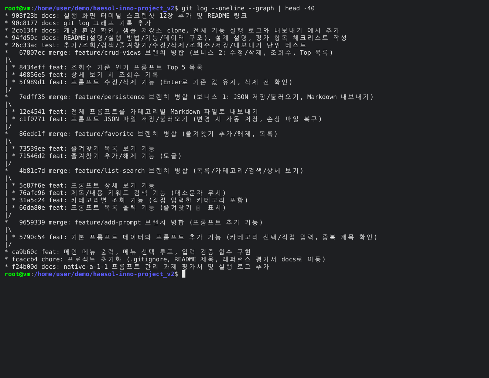

# 나만의 프롬프트 관리 프로그램

자주 쓰는 AI 프롬프트(텍스트·이미지 생성, 코드 작성, 학습/요약, 업무 자동화 등)를
한 곳에서 **등록 · 분류 · 검색 · 즐겨찾기**로 관리하는 Python 콘솔 프로그램입니다.

- 외부 라이브러리 없이 Python 표준 기능(리스트, 딕셔너리, 함수, 조건문, 반복문, `json`, `os`)만 사용합니다.
- 데이터는 `prompts.json`에 자동 저장되어 **프로그램을 종료해도 유지**됩니다. (보너스 1)
- 프롬프트 **수정/삭제**, **조회수 기록**, **많이 본 프롬프트 Top 5**를 지원합니다. (보너스 2)

## 실행 방법

Python **3.10 이상**이 필요합니다.

```bash
# 1. 저장소 내려받기
git clone https://github.com/haesol-inno/haesol-inno-project_v2.git
cd haesol-inno-project_v2

# 2. 버전 확인
python3 --version      # Windows: python --version

# 3. 실행
python3 main.py        # Windows: python main.py

# (선택) 테스트 실행
python3 -m unittest discover -s tests -v
```

실행하면 메뉴가 나오고, 번호를 입력해 기능을 선택합니다. `0`을 입력하면 종료합니다.

```
=== 나만의 프롬프트 관리 ===
1. 프롬프트 추가
2. 프롬프트 목록
3. 카테고리별 조회
4. 프롬프트 검색
5. 프롬프트 상세 보기
6. 즐겨찾기 추가/해제
7. 즐겨찾기 목록
8. 카테고리별 Markdown 내보내기
9. 프롬프트 수정
10. 프롬프트 삭제
11. 많이 본 프롬프트 Top 5
0. 종료
선택:
```

## 기능 목록

| 번호 | 기능 | 설명 |
|---|---|---|
| 1 | 프롬프트 추가 | 제목·내용·카테고리를 입력해 등록합니다. 빈 값은 다시 입력받고, 카테고리는 목록에서 고르거나 직접 입력합니다. 같은 제목이 있으면 경고 후 저장 여부를 묻습니다. |
| 2 | 프롬프트 목록 | 전체 프롬프트를 `번호. [카테고리] 제목 ⭐` 형식으로 보여줍니다. |
| 3 | 카테고리별 조회 | 선택한 카테고리의 프롬프트만 보여줍니다. 직접 입력한 카테고리도 목록에 나타납니다. |
| 4 | 프롬프트 검색 | 키워드가 **제목 또는 내용**에 포함된 프롬프트를 찾습니다 (영문 대소문자 무시). |
| 5 | 프롬프트 상세 보기 | 제목, 카테고리, 즐겨찾기, 조회수, 내용 전체를 보여주고 **조회수를 1 올립니다**. |
| 6 | 즐겨찾기 추가/해제 | 번호를 입력해 즐겨찾기를 켜고 끕니다 (토글). |
| 7 | 즐겨찾기 목록 | 즐겨찾기한 프롬프트만 모아서 보여줍니다. |
| 8 | Markdown 내보내기 | 전체 프롬프트를 카테고리별 `.md` 파일로 `exports/` 폴더에 만듭니다. |
| 9 | 프롬프트 수정 | 제목·내용·카테고리를 수정합니다. Enter만 누르면 기존 값을 유지합니다. |
| 10 | 프롬프트 삭제 | 확인(y/n) 후 삭제합니다. |
| 11 | 많이 본 프롬프트 Top 5 | 조회수가 높은 순으로 최대 5개를 보여줍니다 (같으면 목록 순서). |
| 0 | 종료 | 프로그램을 종료합니다. |

- 잘못된 메뉴 번호, 숫자가 아닌 입력, 범위를 벗어난 번호에는 안내 메시지를 출력합니다.
- 조회·검색·즐겨찾기·Top 결과의 번호는 **전체 목록 기준 번호**라서, 그대로 상세 보기·수정·삭제에 입력할 수 있습니다.
- 데이터가 바뀌는 메뉴(추가, 상세 보기, 즐겨찾기, 수정, 삭제)를 실행하면 바로 `prompts.json`에 저장됩니다.

## 카테고리

| 카테고리 | 설명 |
|---|---|
| 텍스트 생성 | 이메일, 카피, 글쓰기 등 텍스트 결과물을 만드는 프롬프트 |
| 이미지 생성 | 이미지 생성 AI에 넣는 장면·스타일 묘사 프롬프트 |
| 코드 작성 | 코드 작성·리뷰·디버깅 프롬프트 |
| 학습/요약 | 개념 설명, 문서·회의록 요약 프롬프트 |
| 업무 자동화 | 반복 업무를 처리하는 스크립트·자동화 프롬프트 |
| 기타 | 위 분류에 속하지 않는 프롬프트 |

추가하거나 수정할 때 "직접 입력"을 고르면 새 카테고리를 만들 수 있습니다.
카테고리 체계는 `main.py` 상단의 `CATEGORIES` 목록 한 곳에서만 관리합니다.

## 데이터 구조와 저장

프롬프트는 **딕셔너리의 리스트**로 관리하고, 같은 구조 그대로 `prompts.json`에 저장합니다.

```json
[
  {
    "id": 1,
    "title": "회의록 3줄 요약",
    "content": "아래 회의록을 읽고 결정 사항, 담당자, 마감일 중심으로 3줄로 요약해줘. ...",
    "category": "학습/요약",
    "favorite": true,
    "views": 3
  }
]
```

| 필드 | 타입 | 설명 |
|---|---|---|
| `id` | int | 내부 고유 번호 (삭제 후에도 겹치지 않음) |
| `title` | str | 제목 |
| `content` | str | 프롬프트 내용 |
| `category` | str | 카테고리 |
| `favorite` | bool | 즐겨찾기 여부 |
| `views` | int | 상세 보기 조회수 |

- `prompts.json`이 없으면 기본 프롬프트 6개로 시작합니다.
- 파일이 손상되었으면 `prompts.json.broken`으로 보관하고 기본 프롬프트로 시작합니다.
- 저장할 때는 임시 파일에 먼저 쓴 뒤 바꿔치기해서, 저장 도중 문제가 생겨도 기존 파일이 깨지지 않습니다.
- `prompts.json`과 `exports/`는 실행할 때 만들어지는 사용자 데이터라서 `.gitignore`로 저장소에서 제외했습니다.
  예시는 [`docs/logs/prompts_sample.json`](docs/logs/prompts_sample.json), [`docs/logs/export_sample/`](docs/logs/export_sample/)에 있습니다.

## 코드 구조

```
main.py               프로그램 전체 (기능별 함수로 분리)
tests/test_main.py    unittest 기반 기능 테스트 (24개)
docs/DESIGN.md        설계 설명 (함수 분리, 자료구조, 입력 검증, 브랜치 전략, 확장 설계)
docs/CHECKLIST.md     평가 항목별 확인 위치
docs/logs/            개발 환경 확인, 샘플 저장소 clone, 실행 로그, git log
```

| 구분 | 함수 |
|---|---|
| 메뉴 | `show_menu()`, `find_menu_handler()`, `main()` — 메뉴 정의는 `MENU_ITEMS` |
| 메뉴 기능 | `add_prompt()`, `show_list()`, `show_by_category()`, `search_prompt()`, `show_detail()`, `toggle_favorite()`, `show_favorites()`, `export_markdown()`, `edit_prompt()`, `delete_prompt()`, `show_top()` |
| 입력 검증 | `input_non_empty()`, `input_number()`, `confirm()`, `input_or_keep()`, `choose_category()`, `select_prompt()` |
| 조회·출력 도우미 | `find_prompts()`, `matches_keyword()`, `get_all_categories()`, `get_top_prompts()`, `print_matches()`, `print_prompt_line()`, `print_detail()` |
| 데이터 생성·중복 검사 | `make_prompt()`, `next_id()`, `create_default_prompts()`, `normalize_title()`, `find_same_title()`, `check_duplicate_title()` |
| 저장·내보내기 | `load_prompts()`, `save_prompts()`, `normalize_prompts()`, `export_markdown_files()`, `build_category_markdown()`, `safe_filename()`, `code_fence()` |

자세한 설계 이유는 [docs/DESIGN.md](docs/DESIGN.md)에 정리했습니다.

## Git 작업 방식

- 기능마다 `feature/*` 브랜치를 만들어 작업하고, 실행 확인이 끝나면 `--no-ff`로 병합해 병합 기록을 남겼습니다.

  | 브랜치 | 내용 |
  |---|---|
  | `feature/add-prompt` | 기본 데이터, 프롬프트 추가 |
  | `feature/list-search` | 목록, 카테고리별 조회, 검색, 상세 보기 |
  | `feature/favorite` | 즐겨찾기 추가/해제, 즐겨찾기 목록 |
  | `feature/persistence` | 보너스 1: JSON 저장/불러오기, Markdown 내보내기 |
  | `feature/crud-views` | 보너스 2: 수정/삭제, 조회수, Top 목록 |

- 커밋 메시지는 `feat:`(기능), `test:`(테스트), `docs:`(문서), `chore:`(설정), `merge:`(병합) 접두어로 구분했습니다.
- 전체 기록: [docs/logs/05_git_log.txt](docs/logs/05_git_log.txt)

## 실행 기록

| 내용 | 파일 |
|---|---|
| 개발 환경 확인 (Python/Git 버전, user.name/email) | [01_env.txt](docs/logs/01_env.txt) |
| 공개 샘플 저장소 clone | [02_clone.txt](docs/logs/02_clone.txt) |
| 전체 기능 실행 (잘못된 입력, 추가, 목록, 카테고리, 검색, 즐겨찾기, 상세, 수정, 삭제, Top, 내보내기) | [03_run_all_features.txt](docs/logs/03_run_all_features.txt) |
| 재실행 후 데이터 유지 확인 | [04_run_after_restart.txt](docs/logs/04_run_after_restart.txt) |
| `git log --oneline --graph --all` | [05_git_log.txt](docs/logs/05_git_log.txt) |

## 실행 화면 (스크린샷)

Claude Code 클라우드 세션 안에서 실제 터미널(xterm)을 띄워 이 저장소를 새로 clone하고, 명령을 직접 입력·실행한 화면을 그대로 캡처했습니다.
(xterm이 컬러 이모지를 그리지 못해 ⭐ 표시는 네모(□)로 보입니다.)

| 화면 | 파일 |
|---|---|
| 개발 환경 확인 (Python/Git 버전, user.name/email) | [01_env.png](docs/screenshots/01_env.png) |
| 공개 샘플 저장소 clone | [02_clone_sample.png](docs/screenshots/02_clone_sample.png) |
| 과제 저장소 clone 및 테스트 24개 통과 | [03_clone_project.png](docs/screenshots/03_clone_project.png) |
| 메뉴 출력, 잘못된 입력(`99`, `abc`) 처리 | [04_menu.png](docs/screenshots/04_menu.png) |
| 프롬프트 추가 (빈 값·범위 밖 번호 재입력) | [05_add.png](docs/screenshots/05_add.png) |
| 추가한 프롬프트가 목록에 반영 | [06_list.png](docs/screenshots/06_list.png) |
| 카테고리별 조회 | [07_category.png](docs/screenshots/07_category.png) |
| 검색 — 제목에 포함 | [08_search_title.png](docs/screenshots/08_search_title.png) |
| 검색 — 내용에 포함 (대소문자 무시) | [09_search_content.png](docs/screenshots/09_search_content.png) |
| 즐겨찾기 추가 | [10_favorite_on.png](docs/screenshots/10_favorite_on.png) |
| 즐겨찾기 목록 | [11_favorite_list.png](docs/screenshots/11_favorite_list.png) |
| 즐겨찾기 해제 | [12_favorite_off.png](docs/screenshots/12_favorite_off.png) |
| 상세 보기 + 조회수 기록 (보너스 2) | [13_detail_views.png](docs/screenshots/13_detail_views.png) |
| 조회수 Top 5 (보너스 2) | [14_top.png](docs/screenshots/14_top.png) |
| 프롬프트 수정 (보너스 2) | [15_edit.png](docs/screenshots/15_edit.png) |
| 프롬프트 삭제 (보너스 2) | [16_delete.png](docs/screenshots/16_delete.png) |
| 재실행 시 prompts.json에서 불러오기 (보너스 1) | [17_restart_load.png](docs/screenshots/17_restart_load.png) |
| 재실행 후 조회수 유지 + Markdown 내보내기 (보너스 1) | [18_top_export.png](docs/screenshots/18_top_export.png) |
| 내보낸 Markdown 파일 내용 (보너스 1) | [19_export_file.png](docs/screenshots/19_export_file.png) |
| `git log --oneline --graph` 브랜치 병합 기록 | [20_git_log.png](docs/screenshots/20_git_log.png) |


